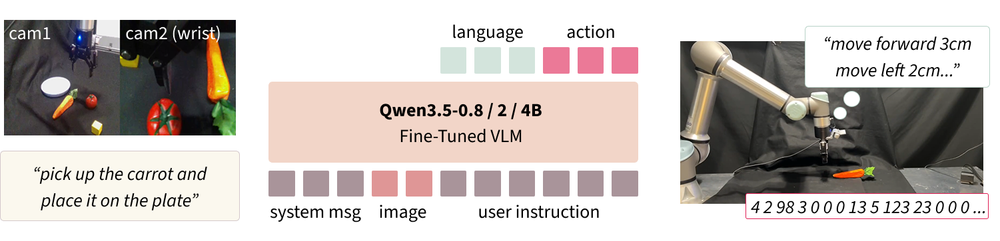

Hi! I am a first-year Computer Science Ph.D. student at the [Vislang Lab](https://vislang.ai/), Rice University, advised by [Prof. Vicente Ordóñez](https://www.cs.rice.edu/~vo9/), and supported by the Toyota Riken Overseas Scholarship. Before joining Rice, I received my B.S. in Information Science from Ochanomizu University in Tokyo, Japan, where I was advised by [Prof. Ichiro Kobayashi](https://www.koba.is.ocha.ac.jp/kobalab/index.php/aboutus/ichirokobayashi/).

My research focuses on multimodal foundation models for embodied AI, especially **low-cost ways to add or strengthen capabilities of pretrained models while preserving what they already know**, from VLM-to-VLA adaptation to interventions on internal representations.

**I am looking for research internship opportunities for Summer 2027**, especially in VLM-to-VLA adaptation, vision-language-action models, and multimodal foundation models for embodied AI. Please feel free to reach out!

My CV is available [here](files/cv_yuriishitoya.pdf).  
Feel free to reach out by email at Yuri.Ishitoya[at]rice.edu! ✉️

## News {#news}

<ul class="news-list">
  <li>[10/2026] Received a CoRL 2026 travel grant.</li>
  <li>[09/2026] <a href="https://omron-sinicx.github.io/clap/">CLAP</a> was accepted to <strong>CoRL 2026</strong>! 🎉</li>
  <li>[08/2026] Started my Ph.D. in Computer Science at Rice University (Vislang Lab).</li>
  <li>[07/2026] Awarded the Toyota Riken Overseas Scholarship for my Ph.D. studies.</li>
  <li>[07/2026] Released <a href="https://arxiv.org/abs/2607.08974">CLAP</a> on arXiv, with <a href="https://github.com/omron-sinicx/clap">code</a> and <a href="https://huggingface.co/collections/omron-sinicx/clap">open-weight models</a>.</li>
  <li>[01/2026] Joined OMRON SINIC X as a research intern.</li>
  <li>[08/2025] Visiting researcher at DFKI Saarbrücken, Germany.</li>
  <li>[03/2025] Received my B.S. in Information Science from Ochanomizu University.</li>
  <li>[02/2025] Visiting researcher at the Vislang Lab, Rice University (TOMODACHI-Dow Women's STEM Leadership and Research Program).</li>
</ul>

## Publications {#publications}

\* Equal contribution.

### Conference Papers

  

  

    
<a href="https://omron-sinicx.github.io/clap/">CLAP: Direct VLM-to-VLA Adaptation via Language-Action Grounding</a>

    
<strong>Yuri Ishitoya</strong>*, Jeremy Siburian*, Masashi Hamaya, Kuniaki Saito, Cristian C. Beltran-Hernandez, Mai Nishimura*

    
Conference on Robot Learning (<strong>CoRL 2026</strong>)

    

      <a href="https://arxiv.org/abs/2607.08974">[Paper]</a>
      <a href="https://github.com/omron-sinicx/clap">[Code]</a>
      <a href="https://huggingface.co/collections/omron-sinicx/clap">[Models]</a>
      <a href="https://omron-sinicx.github.io/clap/">[Project Page]</a>
    

  

### Preprints

- **Ishitoya, Y.**\*, Flores, V.\*, Yang, Z., Cascante-Bonilla, P., & Ordonez, V. (2025). *A People-centric Benchmark for Testing Vision-Language Models*. [[Draft]](https://ishity.github.io/yuriishitoya/image/apa_benchmark_draft.pdf)

### Domestic Conference Papers (in Japanese)

- **Ishitoya, Y.**, & Kobayashi, I. (2026). *Mitigating Statistical and Causal Bias Through Output Embedding Operations*. In Proceedings of NLP2026.
- Ishida, K., **Ishitoya, Y.**, Kobayashi, I., & Igarashi, Y. (2025). *A Study on the Usefulness of an Interviewer Support System that Points Out Gender-Based Judgments*. In Proceedings of IPSJ SIG-HCI 212.
- Ishida, K., **Ishitoya, Y.**, Kobayashi, I., & Igarashi, Y. (2025). *Proposal and Development of an AI Interviewer Support System that Points Out Gender-Based Judgments*. In Proceedings of JSAI2025. [[DOI]](https://www.jstage.jst.go.jp/article/pjsai/JSAI2025/0/JSAI2025_4R2OS1901/_article/-char/en)
- **Ishitoya, Y.**, & Kobayashi, I. (2025). *A Study on Detecting Subtle Biases by Expanding the Log-Likelihood into a Frequency Space*. In Proceedings of JSAI2025. [[DOI]](https://www.jstage.jst.go.jp/article/pjsai/JSAI2025/0/JSAI2025_4R2OS1903/_article/-char/en)
- **Ishitoya, Y.**, & Ito, T. (2024). *Analysis of the Causes of the Gender Gap through Data Comparison and Visualization by the 47 Prefectures*. In Proceedings of JSAI2024. [[DOI]](https://www.jstage.jst.go.jp/article/pjsai/JSAI2024/0/JSAI2024_2N5OS28a03/_article/-char/en)

## Research Experience {#experience}

- 01/2026 – 07/2026, Research Intern, **OMRON SINIC X**, Tokyo, Japan (Host: Dr. Mai Nishimura)
- 08/2025 – 10/2025, Visiting Researcher, **German Research Center for Artificial Intelligence (DFKI)**, Saarbrücken, Germany (Host: Dr. Boris Brandherm)
- 02/2025 – 08/2025, Visiting Researcher, **Vislang Lab, Rice University**, Houston, USA (Host: Prof. Vicente Ordóñez)
- 08/2024, Research Intern, **Fujitsu Ltd., Artificial Intelligence Research Center**, Japan (Host: Dr. Hiroya Inakoshi)

## Funding & Awards {#fundingandwards}
### Funding
- Toyota Riken Overseas Scholarship, 2026
  - Toyota Physical & Chemical Research Institute, Japan
  - Full Ph.D. funding: USD 80,000/year for two years
- CoRL 2026 Travel Grant, 2026
- Tobitate! Study Abroad Initiative, 2025
  - Japan Ministry of Education, Japan
  - Selected as 1 of 263 awardees out of 1,187 applicants (22.1% acceptance rate)
- MITOU IT Program, 2023
  - Information-technology Promotion Agency (IPA), Japan
  - Selected as one of 21 projects out of 153 applications nationwide in FY2023 (13.7% acceptance rate)
- Women Leaders Support Fund, 2023
  - Public Resource Foundation, Japan
  - Selected as one of 6 recipients out of 103 applicants (6.8% acceptance rate)

### Awards
- Oin-kai Research Encouragement Award, Ochanomizu University (2025)
- Pre-Graduation Research Excellence Award, Ochanomizu University (2024)

## Education {#education}

- **Rice University**, USA: Ph.D. in Computer Science, Aug 2026 – Present
- **Ochanomizu University**, Japan: M.S. Program in Information Science, Apr 2025 – Aug 2026 (completed coursework; withdrew to begin Ph.D. at Rice)
- **Ochanomizu University**, Japan: B.S. in Information Science, Apr 2021 – Mar 2025
